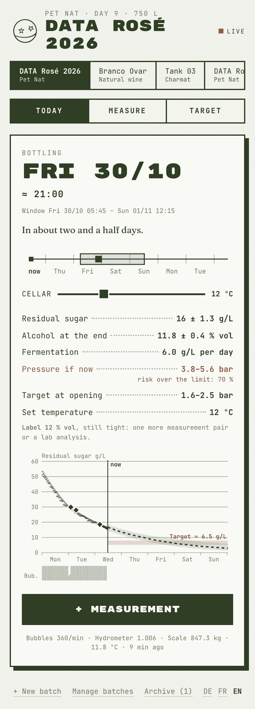
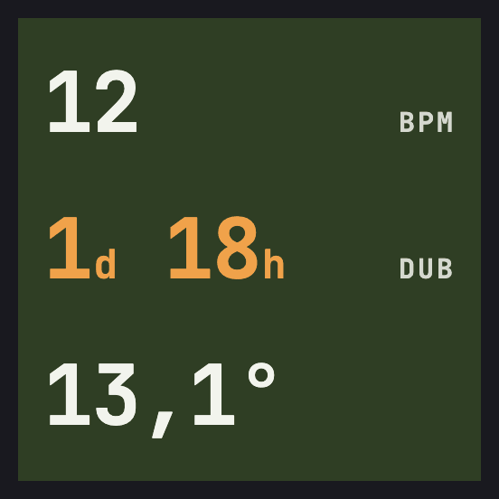

# TIPSYLAB

Fermentation monitoring for small natural-wine cellars: when a Pét-Nat has to go into the
bottle, when a still wine is dry, and which pressure a Charmat tank should hold. Built by
Tipsy Wines (Ovar, Portugal) on Home Assistant, with small sensor boxes on every vessel.

> **Experimental: some of this has not run on real hardware yet.** The integration and the
> forecast are tested against a simulator; some of the box firmwares and the Shelly script have
> not run on devices (see [Status](#status)). TIPSYLAB deals with pressure in bottles and tanks
> and with mains-powered heaters: read [Safety](#safety) first, keep every mechanical safety
> device, and check every bottling with a measurement bottle. Use at your own risk.

**Season 2027:** we are moving from Portugal to the Bordeaux area and will extend TIPSYLAB there.
If you are interested in setting up a system around Bordeaux, write to tipsylab@tipsy.pt; we can
help you set one up, too. More data = more reliability.

The panel and notifications speak English, French and German. The detailed plan in
[`docs/`](docs/PLAN-Abfuellzeitpunkt.md) is in German.

<p align="center">
  
  &nbsp;&nbsp;
  
</p>
<p align="center"><sub>The panel in Home Assistant, here with a simulated batch, and the Gärbox display
(layout from the UI draft in <code>docs/ui-entwurf/</code>).</sub></p>

TIPSYLAB has two parts:

- **The Home Assistant integration** ([`custom_components/tipsylab`](custom_components/tipsylab))
  is the brain. For every batch it collects all sources (your measurements, hydrometer, bubbles,
  weight, temperature), fuses them into a residual sugar with its uncertainty, forecasts the
  bottling window and calculates the pressure in the bottle. After bottling it watches the
  measurement bottle and learns from every finished batch. It comes with the "TIPSYLAB" panel in
  the sidebar, on phone, tablet or PC.
- **The boxes** ([`boxen/`](boxen)) sit on vessels, tanks and in the cellar. They measure, show
  what matters and regulate on site, even without WiFi.

```
 BOXES (on site)                       HOME ASSISTANT                          DISPLAY
 Gärbox      bubbles · ° · weight ─┐
             shows BPM · DUB · ° ◄─┤   TIPSYLAB integration                    TIPSYLAB panel
 Waagebox    weight ───────────────┤    fusion: residual sugar ± σ  ───►       Today · Measure
 Hydrometer  density ──────────────┤    forecast: bottling window, DUB         Target · Tank
 Tankbox     pressure · ° ─────────┤    pressure at opening, bottle limit
             drives the valve ◄────┤    temperature plan, CO₂ target           phone: blueprints
 Heizbox     ° · drives heater ◄───┤    measurement bottle, archive,           for window and alarms
 Flaschenbox    pressure · ° ──────┤    house values
 Kellerluftbox  CO₂ · climate ─────┘
```

## The parts

| Part | What it is | Software | Folder |
|---|---|---|---|
| **Integration** | calculates and stores; panel | Python, Home Assistant integration | [`custom_components/tipsylab`](custom_components/tipsylab) |
| **Gärbox** (fermentation box) | AtomS3R on the airlock: bubbles, wine temperature, optional weight | own firmware (PlatformIO) | [`boxen/gaerbox`](boxen/gaerbox) |
| **Waagebox** (scale box) | AtomS3R with a load cell, for vessels without a Gärbox; also as a package for any ESPHome ESP32 | ESPHome | [`boxen/esphome`](boxen/esphome) |
| **Tankbox** | Charmat: holds the pressure, drives the valve | ESPHome | [`boxen/esphome`](boxen/esphome) |
| **Flaschenbox** (bottle box) | pressure in the measurement bottle after bottling | ESPHome | [`boxen/esphome`](boxen/esphome) |
| **Kellerluftbox** (cellar air box) | CO₂ and climate in the cellar | ESPHome | [`boxen/esphome`](boxen/esphome) |
| **Heizbox** (heater box) | Shelly on the heating jacket | Shelly script | [`boxen/heizbox`](boxen/heizbox) |
| **Notifications** | bottling window and alarms on your phone | blueprints | [`blueprints/automation/tipsylab`](blueprints/automation/tipsylab) |
| **DataWein feed** | real numbers on the website, without exposing Home Assistant to the internet | blueprint, PHP, JavaScript | [`website/datawein`](website/datawein) |

Which box for what, shopping lists, wiring and setup: **[boxen/README.md](boxen/README.md)**.
Background, physics and decisions (in German): [docs/PLAN-Abfuellzeitpunkt.md](docs/PLAN-Abfuellzeitpunkt.md).

## What the integration calculates

- **Pét-Nat:** residual sugar from refractometer, density or lab values, carried forward with
  hydrometer, bubbles and weight. The forecast runs in thermal time, so cooling and the
  temperature plan shift the window, and it varies residual sugar, fermentation rate, Q10 and
  cellar temperature by Monte Carlo: the window is P10–P90, calibrated in the simulator. A
  measurement is recommended when it would make the window noticeably narrower. Result: bottling
  window with uncertainty, DUB, pressure at opening at 10 and 20 °C, a check of the bottle limit
  in the worst case (330 ml 4.5 bar, 750 ml 6 bar), malolactic in the bottle as an option, alcohol
  in the bottle with uncertainty and the value for the label.
- **Natural wine (still):** time until dry, a warning when the fermentation stalls, alcohol for
  the label.
- **After bottling:** "Bottled" freezes the residual sugar, switches the heater off and shows the
  expected opening pressure. The measurement bottle (aphrometer or Flaschenbox) is converted to
  20 °C; if it rises above the expected pressure, there is an alarm with an action ("chill to
  0–2 °C"). "Close batch" moves it to the archive, with a post-calculation of the forecast and the
  house values that new batches use (CO₂ at bottling from the measurement bottle, sugar per % vol
  from lab values, bubbles per g CO₂ for each Gärbox and the offset of each hydrometer).
- **Charmat:** CO₂ target and tank set point from the bottle target; the Tankbox regulates from
  there.
- **Weight:** weight loss is escaped CO₂. With the volume this gives the fermented sugar directly;
  when there are measurements along the way, it is calibrated against them. The integration takes
  dissolved CO₂ and samples into account. Under a tank with three legs one load cell is enough.
- **Sources in view:** "Source silent" when a hydrometer, Gärbox, scale, probe or measurement
  bottle has sent nothing for over 3 h; "Battery low" below 20 % on devices with a battery, such
  as a RAPT Pill. Both come with an action for the notification.

## Setup

Install with HACS, or copy the folders by hand: `custom_components/tipsylab` to
`/config/custom_components/` and `blueprints/automation/tipsylab` to `/config/blueprints/automation/`.

1. **Integration:** HACS → Custom repositories → `https://github.com/studioanarc/tipsylab`, type
   Integration → install TIPSYLAB (without HACS: copy `custom_components/tipsylab` into the folder
   of the same name in your Home Assistant configuration). Restart Home Assistant 2025.8 or newer
   (tested with 2026.2). The Gärbox and its display need the MQTT integration.
2. **Boxes:** build and set them up: [boxen/README.md](boxen/README.md).
3. **Create a batch:** Settings → Devices & services → Add integration → TIPSYLAB. Every batch is
   one entry: name, mode, starting Brix or starting gravity, volume, then the sources (Gärbox ID,
   hydrometer, temperature, scale, Shelly; for Charmat the tank pressure and the CO₂ target), then
   the target. Sources can be changed later with "Reconfigure", for example to add a scale;
   measurements are kept. Any gravity entity works as a hydrometer: iSpindel or GravityMon, the
   RAPT Pill via the "RAPT Bluetooth" integration, a Tilt via "Tilt Hydrometer BLE" (unit SG in
   each case). In the cellar the Kellerluftbox receives them as a Bluetooth proxy; set the RAPT
   Pill to Bluetooth in the RAPT app.
4. **Panel** "TIPSYLAB" in the sidebar: enter measurements, set the target. The same services
   (`tipsylab.add_measurement`, `add_event`, `update_settings`) are available for automations. The
   panel follows the language of Home Assistant; at the bottom it can be switched to German,
   French or English (for this browser). Entities, setup and the actions in notifications follow
   the language of the server.
5. **Notifications:** Settings → Automations & scenes → Blueprints → Import blueprint:
   - `https://github.com/studioanarc/tipsylab/blob/main/blueprints/automation/tipsylab/abfuellfenster.yaml`
   - `https://github.com/studioanarc/tipsylab/blob/main/blueprints/automation/tipsylab/alarm.yaml`

   In both, choose the language of the message. In "TIPSYLAB · Alarm aufs Handy" (alarm to your
   phone), add the batches' "Source silent" and "Battery low" next to the alarms of the boxes.

## Safety

- **Charmat:** a mechanical safety valve within the rating of the tank is mandatory; the control
  never replaces it. The set point stays at least 0.3 bar below it. The solenoid valve is normally
  closed and direct-acting; on a sensor fault it stays closed.
- **Heating:** off above 26 °C and without a probe reading, even without Home Assistant; if the
  script stops, the Shelly switches off after two minutes. 230 V only by a qualified electrician.
- **Pressure in the bottle:** calculated for complete fermentation of the residual sugar. Without
  your own measurement bottles the model can be off by about ±0.8 bar, calibrated by about
  ±0.3 bar (plan 2.9). Check every bottling with a measurement bottle and an aphrometer.
- **Scale under a tank:** a load cell secured against slipping; almost a tonne rests on it.

## Development

```
custom_components/tipsylab/   integration; core/ calculates without Home Assistant, frontend/ is the panel
boxen/                        software of the boxes (gaerbox/, esphome/, heizbox/) and their docs
blueprints/                   notifications, DataWein feed
website/datawein/             receiver (PHP) and script of the DataWein page
docs/                         plan and UI draft (German)
tools/                        pressure model, simulator, generators for translations and display font, panel preview
tests/                        core against the simulator, integration in Home Assistant, panel physics
assets/                       logo for the Gärbox display
```

```bash
uv sync && uv run pytest                   # all tests (Home Assistant 2026.2)
python3 tools/druckmodell.py               # pressure tables from the plan
python3 tools/simulator.py                 # simulated batch with forecast
python3 tools/make_translations.py         # strings.json and translations/ from one source
cd boxen/gaerbox && pio run                # build the Gärbox firmware
esphome config boxen/esphome/tankbox.yaml  # needs boxen/esphome/secrets.yaml
```

The physics exists twice: `core/physics.py` for the integration and `frontend/physics.js` for the
sliders in the panel; a test compares both. The panel can be viewed without Home Assistant: see
the instructions in [`tools/panel-vorschau/index.html`](tools/panel-vorschau/index.html). The
screenshots in [`docs/screenshots/`](docs/screenshots) come from that preview
(`?tab=today&narrow=1&w=420&lang=en`) and from the display in the UI draft.

## Status

Done: integration with panel, forecast with a Monte Carlo window, pressure model, weight as a
source, alcohol for the label; after bottling the measurement bottle with alarm, archive,
post-calculation and house values; "Source silent" and "Battery low"; interface, entities and
notifications in German, French and English; Gärbox firmware 2.2 with display and optional scale;
ESPHome for the Tankbox, Waagebox, Flaschenbox and Kellerluftbox (with a Bluetooth proxy for
hydrometers); Heizbox script; blueprints.

Plus the public feed for the DataWein page (receiver and page in [`website/datawein`](website/datawein)).

Still open from the plan are only the phase 6 extras: cooling via Home Assistant, a colorimeter,
fill level.

Tested is what works without hardware: tests against a simulator with a known truth, builds,
configuration checks, the panel in the browser with real data from the integration, and the Shelly
script in a simulation. Not yet run on a device: Gärbox firmware 2.1/2.2, the ESPHome boxes (on
the displays, offset and colours may be off) and the Shelly script.

## License

The code is under the [MIT License](LICENSE). The fonts in
`custom_components/tipsylab/frontend/fonts/` and the display font generated into
`boxen/gaerbox/include/` are under the SIL Open Font License (see the `OFL-*.txt` files next to
them). The TIPSY name and logos (`assets/`, `custom_components/tipsylab/frontend/tipsy-logo.svg`)
are not covered by the license.
